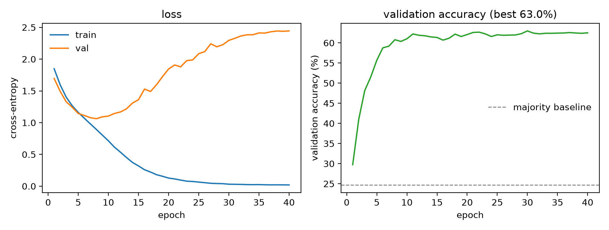

# FER2013 Emotion Recognition

A 7-class facial expression classifier on FER2013, rebuilt from a 2025 course
project so that every number in it can be recomputed by someone else.

Original work: *Fundamentals of Artificial Intelligence*, Zhejiang University,
January 2025. This repository adds the parts the course project skipped —
a reproducible split, evaluation on the untouched official test rows, a
proper ONNX export with numerical verification, and CPU latency benchmarks.

## Status and handoff

- `docs/HANDOFF.md` — what is done, what is missing, environment, known pitfalls.
- `NEXT_SESSION_PROMPT.md` — prompt to hand this repository to another machine/agent.
- `docs/experiment-log.md` — one row per run, and the findings.

## Results

Two different splits, and the difference matters:

- **official** — the `Usage` column FER2013 ships with: 25,838 training rows
  (a 2,871-row validation slice carved out of them) and **7,178 test rows**
  (`PublicTest` + `PrivateTest`) never seen during training. This is the
  number that can be compared with published work.
- **legacy** — what the 2025 coursework did: a random 90/10 split. FER2013
  frames are not independent (the same identities and near-duplicate frames
  appear on both sides), so this split leaks and is kept only to stay
  comparable with the original report.

| checkpoint | split | epochs | test rows | accuracy | macro-F1 |
| --- | --- | --- | --- | --- | --- |
| `cnn40-official_best.pth` | official | 40 | 7,178 | **63.81%** | **0.6295** |
| `model_epoch_5.pth` | legacy | 5 | 3,589 | 59.43% | 0.5354 |
| `model_epoch_10.pth` | legacy | 10 | 3,589 | 63.39% | 0.6046 |
| `cnn40-legacy_best.pth` | legacy | 40 | 3,589 | 63.95% | 0.6310 |

Majority-class baseline is 24.71% on the official test rows and 24.55% on the
legacy ones; chance is 14.3%. Every figure above comes from
`src/evaluate.py` and is stored in `results/metrics_*.json`.



The curve is the honest part of the result: validation accuracy is flat from
about epoch 8 while validation loss climbs from 1.1 to 2.44, so 40 epochs
buy almost nothing over 10 (63.39% → 63.95% on the legacy split). The
remaining error is capacity, augmentation and class imbalance, not training
time.

Per class, official split, 40 epochs:

| class | precision | recall | F1 | support |
| --- | --- | --- | --- | --- |
| angry | 0.542 | 0.573 | 0.557 | 958 |
| disgust | 0.759 | 0.568 | 0.649 | 111 |
| fear | 0.509 | 0.473 | 0.490 | 1,024 |
| happy | 0.824 | 0.819 | 0.822 | 1,774 |
| sad | 0.513 | 0.526 | 0.520 | 1,247 |
| surprise | 0.806 | 0.768 | 0.786 | 831 |
| neutral | 0.567 | 0.598 | 0.582 | 1,233 |

Accuracy is reported alongside macro-F1 because the classes are badly
imbalanced (111 disgust images against 1,774 happy): a model can raise
accuracy by ignoring the small classes, and macro-F1 will not. `fear` and
`sad` are where the model actually fails.

## Model comparison

6 models, official split, 20 epochs each, batch 256, Adam 1e-3 with cosine
decay, seed 42, single RTX 5070 Ti. Latency is `src/latency.py`: CPU,
1 thread, batch 1, median of 50 runs after 10 warm-up runs, AMD Ryzen 7 9700X.

| model | parameters | test accuracy | macro-F1 | CPU latency |
| --- | --- | --- | --- | --- |
| `cnn-light` | 939,351 | 60.43% | 0.5937 | 0.62 ms |
| `cnn-small` | 1,274,823 | 60.57% | 0.5951 | 0.90 ms |
| `emotioncnn` | 10,927,751 | **63.00%** | **0.6239** | 3.74 ms |
| `mlp-small` | 1,183,751 | 45.96% | 0.4320 | 0.06 ms |
| `mlp-medium` | 3,417,095 | 46.99% | 0.4605 | 0.15 ms |
| `mlp-large` | 8,931,335 | 48.72% | 0.4865 | 0.74 ms |

`emotioncnn` is the "deep" CNN in this table: `src/model.py` registers six
models and there is no separate `cnn-deep`. The trade-off is worth stating
plainly — 11.6× the parameters and 6× the CPU time of `cnn-light` buy 2.6 pp
of accuracy, while the MLPs run in 0.06–0.74 ms and are 11.5–17 pp worse.

## CPU latency, PyTorch vs ONNX

`src/benchmark.py`, 1 thread, 50 runs after 10 warm-up runs, Apple silicon,
PyTorch eager vs ONNX Runtime 1.31.1:

| batch | PyTorch (median) | ONNX Runtime (median) | speed-up |
| --- | --- | --- | --- |
| 1 | 1.71 ms | 1.07 ms | 1.60× |
| 32 | 60.57 ms | 36.95 ms | 1.64× |

These milliseconds were measured on a different CPU from the table above and
are not comparable with it; within this table they are consistent.

The ONNX export is verified, not assumed: `src/export_onnx.py` runs both
runtimes on the same batch and fails unless the logits agree within 1e-5
(measured difference: 5.2e-06).

## Reproduce

```bash
python3 -m venv .venv && .venv/bin/pip install -r requirements.txt

# Blackwell (RTX 50xx) needs the cu128 wheels, otherwise torch fails at the
# first kernel launch with "no kernel image is available":
#   pip install torch --index-url https://download.pytorch.org/whl/cu128
# Any other GPU/CPU works with the plain requirements.txt.

# data (not in this repo): FER2013 CSV from Kaggle, one file
#   data/fer2013/fer2013.csv
# Either column order works ("emotion,pixels,Usage" or "emotion, Usage, pixels").

.venv/bin/python -m src.split --mode legacy                          # data/fer2013/
.venv/bin/python -m src.split --mode official --out data/fer2013_official
```

The two headline runs (`--out` for the second one is not optional: the
default would overwrite the legacy split files):

```bash
.venv/bin/python -m src.train --model emotioncnn --data-dir data/fer2013_official \
    --device cuda --batch-size 256 --epochs 40 --tag cnn40-official
.venv/bin/python -m src.evaluate --checkpoint checkpoints/cnn40-official_best.pth \
    --split data/fer2013_official/test.csv --out results/metrics_official.json \
    --figure results/figures/cm_official.png

.venv/bin/python -m src.train --model emotioncnn --data-dir data/fer2013 \
    --device cuda --batch-size 256 --epochs 40 --tag cnn40-legacy
.venv/bin/python -m src.evaluate --checkpoint checkpoints/cnn40-legacy_best.pth \
    --split data/fer2013/test.csv --out results/metrics_legacy40.json
```

`scripts/run_all.sh` chains split → train → evaluate → export → benchmark for
a single model; it runs on the legacy split.

## Repository layout

```
src/dataset.py      CSV -> (N, 48, 48) uint8 -> tensor in [-1, 1]
src/model.py        EmotionCNN (10.93M parameters) + lighter CNNs and MLPs
src/split.py        legacy random split or the official Usage-based split
src/train.py        training loop with per-epoch validation accuracy
src/evaluate.py     accuracy, macro-F1, per-class metrics, confusion matrix
src/export_onnx.py  ONNX export + numerical parity check
src/benchmark.py    CPU latency, PyTorch vs ONNX Runtime
src/latency.py      CPU latency for several checkpoints, one model per row
src/plot_history.py training curves from a history JSON
scripts/            one-command pipelines
results/            metrics JSON, histories, logs and figures
docs/               experiment log, handoff notes
```

## Known limitations

These are stated up front because they bound what the numbers mean.

1. **The shipped checkpoints are not in the repository.** `checkpoints/` is
   gitignored, including `model_epoch_5.pth` and `model_epoch_10.pth`, so
   `scripts/reproduce_published.sh` — and the 63.39% row — cannot be rerun
   from a fresh clone. Retraining from scratch reproduces the ballpark
   (63.95% for the same protocol) but not the exact weights.
2. **The legacy split leaks identities.** 63.39% and 63.95% are random-split
   numbers; they are comparable with the original course report and with each
   other, not with published FER2013 results. Use 63.81% for that. (The
   measured gap between the two splits is only 0.14 pp, but that is an
   observation about this model, not a licence to quote the legacy number.)
3. **No augmentation, no class weighting.** The class imbalance is partly
   compensated for in reporting (macro-F1) but not in training, which is why
   `fear` and `sad` sit near 0.5 F1.
4. **Latency is desktop CPU, not an edge device.** 0.9 ms on a laptop says
   little about a Jetson-class board under an INT8 runtime.
5. **No ensembling or test-time augmentation.** Published FER2013 results
   above 70% rely on both.

## Data and license

FER2013 comes from the ICML 2013 representation learning challenge
(Kaggle: `deadskull7/fer2013`) and is not redistributed here. Code in this
repository is MIT licensed.
